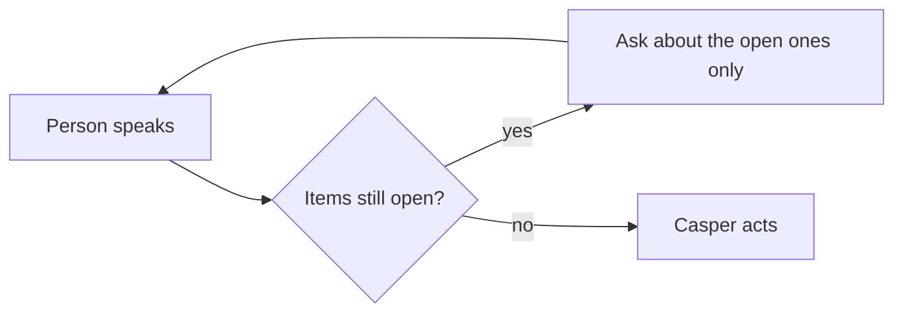
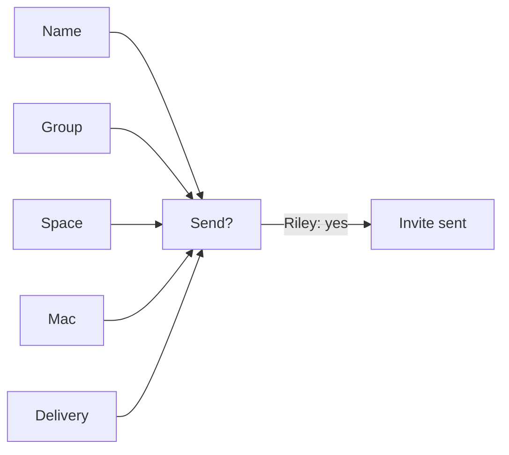
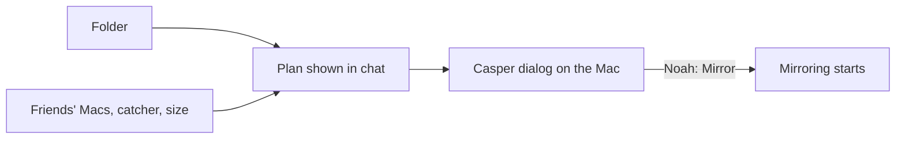
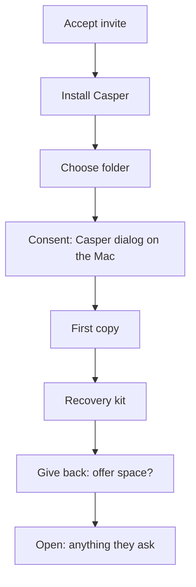
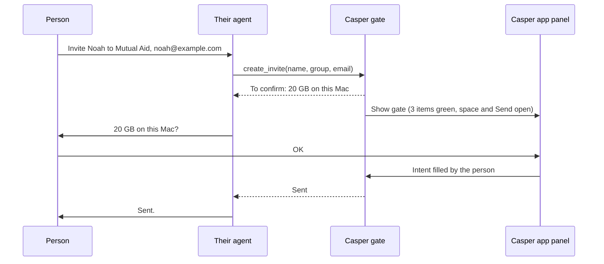

# Gates: how Casper decides it may act

Written 2026-10-13. How the gated process works today, and a proposal for
where it goes next. Related: [agent-first-ux.md](agent-first-ux.md) (the
principles this builds on) and [trust-framework.md](trust-framework.md).

## 1. The model in one paragraph

Every action Casper takes passes through a **gate**. A gate has **items**.
**Info items** are facts: who, which folder, how much space. **Intent
items** are the person's decision: "yes, send it". An item is filled
either by the person's own words or by their yes to a suggestion. A
default fills an item only once the person affirms it; silence never
counts. When the last item is filled, Casper acts, with no further
"are you sure?". Until then it asks only about what isn't established yet.
Example: Riley says "Invite my friend Noah to Mutual Aid" and gives Noah's
email. Name, group and delivery are filled. Only the space is open, so the
one question is "20 GB on this Mac?", and Riley's yes is also the go-ahead.

None of this is new. The established terms:

- **Frame or slot filling**: task-oriented dialogue fills a form ("frame")
  of slots from what the user says (Bobrow's GUS, 1977). **Slot
  elicitation** is asking for a missing slot. **Explicit confirmation**
  asks "did you mean X?"; **implicit confirmation** echoes X inside the
  next step. **Fulfillment** is acting once the frame is complete.
- **Informed consent**: disclosure, comprehension, voluntariness,
  capacity, authorization (Faden & Beauchamp; the Belmont Report).
- **GDPR consent**: "specific, informed and unambiguous", by a "clear
  affirmative act", and the controller must be able to demonstrate it.
- **Consent receipts** (Kantara): a record, given to the person, of what
  they agreed to.
- **Dynamic consent**: consent as an ongoing, revisable relationship rather
  than a one-time signature.
- **Trusted path**: a channel to the person that the software in between
  (here, an agent) can't fake or operate.

## 2. Who may fill an item

Each item says who may fill it and through which channel.

- **Info items** can come from the person's words, relayed by any agent,
  or from Casper's own records. Casper never asks for what it can look up
  (which Macs they have, how big a folder is).
- **Intent items** must come from the person themselves, right after
  Casper itself has shown the key terms in the same sitting
  (comprehension), through a surface their agent can't operate when it
  matters (trusted path). Today those surfaces are Casper's dialog on the
  Mac, the buttons on Casper's own web pages, and Telegram buttons.

Example: the invite email has a button, "Accept the invitation". Clicking
it can't be informed consent, because the email isn't Casper presenting the
terms; the click only opens a page. That button should read "See the
invitation", open the invite page, and the yes should happen there, after
Casper (or its guide) has said what accepting means.

## 3. Three gates

### Invite (Riley)

| Item | Kind | Who may fill it | Channel | Default |
|---|---|---|---|---|
| Friend's first name | info | Riley | any chat | none |
| Group | info | Riley (asked the first time) | any chat | their only group |
| Space | info | Riley's yes | any chat | 20 GB |
| Which Mac | info | Casper's records | none needed | their only Mac |
| Delivery | info | Riley | any chat | none (or "they pass it on") |
| Send | intent | Riley | today: any chat; ideally a Casper surface | none |

### Accept (Noah)

| Item | Kind | Who may fill it | Channel | Default |
|---|---|---|---|---|
| Invite code | info | the link, or Noah pasting it | invite page, any chat | none |
| What it gives (inviter, space, friendship, "Riley can't read it") | info | Casper, from the invite | Casper presents it | none |
| Accept | intent | Noah | invite page or guide, after the terms | none |

### Mirror (Noah)

| Item | Kind | Who may fill it | Channel | Default |
|---|---|---|---|---|
| Source Mac | info | Casper's records | none needed | their Mac |
| Folder | info | Noah (words, or the folder panel on his Mac) | any chat, Casper's panel | suggested: Documents |
| Friends' Macs | info | Casper, from the space he holds | none needed | all of them |
| Catcher | info | Casper, from what he holds | none needed | a friend's catcher, else none |
| It fits | info | Casper checks the size | none needed | none |
| Start | intent | Noah | **Casper's dialog on his Mac**, or Telegram | none |

Mirror is the clearest trusted-path case, and the only one enforced today.
No agent can click Casper's native dialog, so even a careless or
manipulated agent can't start a mirror on its own.

## 4. Today, with Casper's own guide

The guide is the chat for people without an agent (web and Telegram, one
shared conversation). Its gating works like this:

- **Facts come from Casper's state, never from the conversation.** Before
  every model call the server reads: is an invite open or accepted, is a
  Mac paired, what space they hold, is a folder waiting for consent or
  active, is it protected, is the recovery kit made, do they offer space.
  (The one thing read from the chat is the invite code they pasted, and
  that is checked against the database.)
- **One current step.** From those facts the server picks exactly one step.
- **Narrow turns.** Each model turn gets that step's instruction ("NOW"),
  only that step's tools plus the read-only ones, and often the exact line
  to say when the step begins. Calling another step's tool is refused.
  A plan previewed in a turn can't be carried out in that same turn: it
  waits for the person's answer.
- **Buttons are clicked by the person** ("Accept", "Documents", "Later").
- **State changes open the next step.** When the Mac connects or the
  dialog is answered, the page notices and the guide carries on by itself.

Plainly: **the model is the voice, the server is the authority.** The
model words things and fills info items from what the person says; it
can't skip a step, act out of turn, or start a mirror.

## 5. Today, with a person's own agent

Claude Code and other agents connect over MCP. They get:

- **all tools at once**, no steps;
- **written instructions** sent silently on connect (the voice and the
  rules: preview first, act only on a yes, never pick a folder for them);
- **preview by default**: sharing tools (invite, accept, mirror, offer
  space) only describe the plan unless called again with preview off.

This is an honor system. Nothing stops an agent from calling with preview
off before the person said yes. The exception is mirroring: the call only
creates a "waiting" folder and opens Casper's dialog on the Mac, and
nothing moves until the person clicks Mirror there (or answers in
Telegram).

## 6. Proposal: one gate engine for every agent

Move the gate itself onto Casper's server, the same for the guide and for
anyone's own agent.

- **Gate state lives on the server**: which items are filled, by whom,
  when, and what the person was shown.
- **Every agent is a filler of info items.** A tool call with items
  missing doesn't act; it answers "needs: friend's name; to confirm:
  20 GB on this Mac". The agent asks, then calls again. Preview stops
  being a flag agents must remember; it's simply what an incomplete gate
  returns.
- **The intent item is never filled by an agent.** The Casper app, the
  guide page and Telegram show the gate beside the conversation: items
  fill in and turn green, and the person's own "OK" is clicked there. The
  visualization is also the trusted path: what they see is exactly what
  they approve, on a surface the agent can't operate.
- **MCP elicitation**, a newer MCP feature, lets a server ask the client
  app to show the person a small form. It could carry info items
  ("Noah's email?") and would help, but client support varies, and the
  form is drawn by the agent's app, not by Casper. So it can gather
  facts, while the final yes still belongs in Casper's own surface.

Benefits: the guide and outside agents behave alike; the gate record is a
natural consent receipt; and "what did I agree to?" has one answer.

## 7. Open questions

- May a person's own agent ever fill an intent item (delegated consent),
  say for small, reversible actions they've pre-approved?
- How long does a disclosure stay "fresh"? Minutes, the same sitting, or
  until the terms change?
- Consent receipts and revocation: what record does the person get, and
  does revoking point back at it?
- What the gate panel looks like on the web, in the Mac app, and in
  Telegram (which has only text and buttons).
