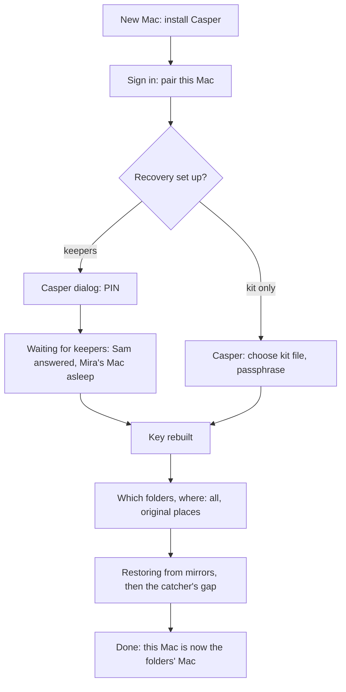

# Recovery v2: technical design

Written 2026-10-15. This is the design pass for the direction decided in
[recovery.md](recovery.md). Part 1 is the overview in plain words. Part 2 is
the technical detail to build from. Part 3 is the build plan, and part 4
lists the questions that need the Principal's answer. Related:
[gates.md](gates.md), [community-model.md](community-model.md),
[scenarios/mirroring.md](scenarios/mirroring.md).

---

## Part 1. Overview

**What we're building.** Today, getting your folders back after losing your
Mac depends on a file (the recovery kit) and a long passphrase, and that's
all. Most people won't keep either safe. With v2, you get your folders back
by signing in on a new Mac and typing a 4-digit PIN. Your friends' Macs
quietly do the rest.

**How it works, in five sentences.**

1. **One master key.** The first time Casper runs for you, your Mac makes
   one secret key and keeps it in your Mac's Keychain. Every folder's
   password is calculated from it, so one key opens everything, including
   folders you start mirroring later.
2. **Your keepers.** That key is split into pieces, and each piece goes to a
   friend's Mac (your "keepers"). With 3 keepers, any 2 pieces rebuild the
   key and 1 piece alone is useless. A piece is a few hundred bytes, so a
   friend with no spare disk can still be a keeper. If you have only one
   friend, Casper itself keeps one piece, but never enough to open anything
   alone.
3. **Your PIN.** On a new Mac you type your 4-digit PIN in Casper's own
   window. Your keepers' Macs check it **without ever seeing it**, and hand
   over their pieces only if it's right. Each keeper's Mac allows about 10
   wrong tries and then stops answering. A thief gets roughly 15 guesses
   out of 10,000 possible PINs, a 0.15% chance, and you're told about every
   try.
4. **Your folders come back.** Once the key is rebuilt, the new Mac pulls
   your folders back from the friends who mirror them (and the catcher's
   most recent changes), and then carries on as your Mac.
5. **If you forget your PIN (only if you chose this).** You can ask to
   recover without it. You and all your keepers are told at once, by every
   channel Casper has. If nobody stops it within 48 hours, the keepers'
   Macs release their pieces. It's off unless you turn it on.

**The PIN check, in plain words.** Your PIN is never stored anywhere, not
on Casper's server and not on a friend's Mac. Each keeper holds a piece of
a "PIN lock" as well as a piece of your key. To test a PIN you have to ask
at least two keepers' Macs to work on it together, and each time you ask,
their Mac counts one try. That's why a single friend who meddles with their
own Mac still can't test PINs on their own: they'd need the other keepers'
Macs for every guess, and those Macs are counting. This design follows the
one Signal and the Juicebox project use to protect short PINs, with
friends' Macs in the place of their servers.

**What stays true (the risks we accept).**

- **Two keepers acting together can open your folders.** That's the trust
  you place in choosing them, the same as giving two friends spare keys.
  With only one friend, that friend plus Casper's own keeper is enough.
- **A friend could tamper with their own Mac.** It gains them a few
  guesses at your PIN (about 20 in 10,000), not your key.
- **If Casper's server is broken into,** the attacker can try guessing
  like a thief can (and you're told), but can't read your folders or learn
  your PIN. The one gap: an attacker who controlled the server *at the
  moment you set up recovery* could swap in their own keys for your
  keepers'. We name this and plan to close it later (see 2.3.7).
- **If too many keepers are gone at once and you have no kit,** your
  folders can't be recovered. Casper watches for this and asks you to add
  a keeper before it gets that far.
- **A 4-digit PIN is the weakest link,** by design: it's what people
  remember. Six digits would cut every guessing risk above by 100 times.

**The kit stays, as an option.** Anyone who wants their own copy can still
save a recovery kit. It now holds the master key, so it never goes out of
date, and Casper won't let you save it inside a folder that's being
mirrored.

**What must happen before pilot users** (part 3.2): the kit must never be
saved into a mirrored folder, people must be able to recover without an
agent, and a recovered Mac must become the folder's Mac again. We also
recommend landing the master key before the pilot, so pilot users' folders
never need migrating.

---

## Part 2. Technical design

### 2.1 Current state (what this changes)

| Piece | Today | File |
|---|---|---|
| Folder password | 32 random bytes per folder, base64url, created by `GetOrCreate` on first reconcile; Keychain service `Casper Mirror Keys`, account `<authDomain>/<username>/<folderID>`, local (`AccessibleAfterFirstUnlock`) | `agent/internal/mirrord/passwords.go`, `keychain_darwin.go` |
| Use of it | `mirror.Manager.Apply` sets it as `encryptionPassword` on every untrusted (mirror, catcher) device of the owned folder | `agent/internal/mirror/manager.go` |
| Backup keys | age X25519 + ed25519, Keychain `Casper Backup Keys` (tries iCloud-synchronizable first) | `agent/internal/backup/keys.go`, `keychain_darwin.go` |
| Kit | v2 JSON {account, auth domain, all mirror passwords, backup keys}, age scrypt, saved to `~/Documents/Casper Recovery Kit (<user>).txt` | `agent/internal/setup/commands.go` (`recoveryKit`, `restore`), `setup.go` (`recoveryKitPath`) |
| Restore | `setup restore --kit` imports passwords; the agent calls MCP `restore_folder`, which sets `mirror_folders.restore_host_id/restore_path`; the new Mac's copy is `receiveonly` and the catcher's gap is overlaid | `casper_service/main.py` (`_mcp_restore_folder`), `mirroring.py` (`desired_state`), `mirrord/service.go` |
| Guide | `recovery_kit` stage after the first copy; app reports `POST /profile/recovery-kit` | `casper_service/guide.py`, `main.py` |

Gaps found while reading the code, beyond those in recovery.md:

- **No promotion after restore.** A restored folder stays `receiveonly` on
  the new Mac, and `owner_host_id` still names the lost Mac, so new changes
  on the new Mac are never mirrored. Nothing turns the new Mac into the
  folder's Mac.
- **Restore has no gate.** `restore_folder` is an agent tool with no intent
  item. It's harmless today only because the password must already be on the
  destination Mac.

### 2.2 The master key

**Generation.** On the person's Mac, by the daemon, per paired identity
(one daemon can carry several accounts; each gets its own key):
`M = 32 bytes from crypto/rand`. It's created the first time the identity
reconciles mirroring with the v2 daemon (a new folder needs a password), or
when recovery is set up, whichever comes first. A Mac that is *restoring*
never creates `M`: it must come from keepers or the kit, the same rule
`GetOrCreate(create=false)` follows today.

**Storage.** The login Keychain, generic password, service
`Casper Master Key`, account `<authDomain>/<username>`,
`AccessibleAfterFirstUnlock`, **not synchronizable** (as decided: login
Keychain, local). A new package `agent/internal/recovery` owns it behind a
`KeyStore` interface (Keychain on macOS; a file store for
`casper-testdaemon`, like `FilePasswords` today).

**Derivation** (HKDF-SHA256, [RFC 5869](https://www.rfc-editor.org/rfc/rfc5869)),
salt `"casper-v2"`, distinct `info` per purpose:

| Purpose | info | Output |
|---|---|---|
| Folder password | `"folder-password\x00" + folderID` | 32 bytes, base64url (same format as today's random ones) |
| Recovery signing key | `"recovery-signing"` | ed25519 seed |
| Wrapping key for the legacy bundle | `"legacy-bundle"` | 32-byte XChaCha20-Poly1305 key |
| Sealing the owner's recovery state (2.3.2) | `"recovery-state"` | 32-byte XChaCha20-Poly1305 key |
| Later: backup keys | `"backup-age"`, `"backup-signing"` | not in v2 (see 2.2.2) |

The folder ID (`casper-<16 hex>`) is chosen by casper_service. Binding the
password to the ID is safe even if the server is hostile: it learns nothing
from choosing IDs. A server that reused one ID for two folders would make
two folders share a password; the daemon guards against this by recording
each `(folderID, path)` it has derived for and refusing a second path.

`mirrord.Service.Step` changes from `GetOrCreate(...)` to a `KeySource`:

```go
type KeySource interface {
    // FolderPassword returns the folder's password: derived from M for
    // scheme "derived1", or the carried legacy password for "legacy".
    // ("", ErrNoMasterKey) on a Mac that hasn't recovered M yet.
    FolderPassword(identity, folderID, scheme string) (string, error)
}
```

`OwnedFolder` (desired state) gains `key_scheme` (`"legacy"` or
`"derived1"`), from a new `mirror_folders.key_scheme` column (default
`'derived1'` for new rows; existing rows migrated to `'legacy'`).

#### 2.2.1 Migration of existing folders

Two options:

- **Re-key** (give the folder a derived password). Syncthing fixes an
  untrusted device's copy to the password it was first shared with, and
  every stored version is encrypted under it
  ([Syncthing: untrusted devices](https://docs.syncthing.net/users/untrusted.html)).
  Changing it means removing and re-adding the folder on every mirror and
  catcher: a full re-upload, and **the 30 days of history are lost**.
- **Carry** (recommended). The existing random passwords are frozen into a
  **legacy bundle**: `{folderID: password}` plus this identity's backup
  keys, sealed with XChaCha20-Poly1305 under `HKDF(M, "legacy-bundle")`,
  stored on casper_service (`PUT /hosts/legacy-bundle`, ciphertext only)
  and copied into the kit. Nothing re-uploads and history is kept. The
  bundle is written once at migration and never grows, because every
  folder created afterwards is derived. The server can't open it: `M` is a
  256-bit random key, so there's nothing to guess.

Re-keying stays possible later as an explicit "fresh start" for one folder.

#### 2.2.2 Backup keys

Peer backup is superseded by mirroring. v2 carries existing backup keys in
the legacy bundle and doesn't derive new ones. If peer backup is ever
revived, derive its keys from `M` too.

#### 2.2.3 A person's own other Macs

Not in v2's first phases. If someone has two Macs with Casper, the second
should receive `M` directly from the first (approved in Casper's dialog on
the first), the way iCloud Keychain adds a device. That makes "my other Mac"
the easiest recovery of all. It's noted here so the key store is per
identity, not per Mac, from the start.

### 2.3 Keepers and the PIN

#### 2.3.1 Options for the PIN check, against the threat model

Threats: (T1) **Casper's server compromised** (it relays every message and
can impersonate the account to keepers); (T2) **one dishonest friend**
(can reset their own counter, copy everything they store, and run their
own code); (T3) **stolen Casper account** (an attacker signs in and pairs
their own Mac); (T4) **offline guessing** by anyone holding stored data.

| Option | How it checks the PIN | Fails on |
|---|---|---|
| A. Per-keeper hashed PIN | Each keeper stores `hash(salt, PIN)` and its share; compares, counts | **T2, fatally.** A 4-digit PIN falls to 10,000 offline hashes in milliseconds, whatever the hash cost. The dishonest friend then has the real PIN, asks the other keepers through Casper, and gets the key. |
| B. OPAQUE per keeper ([RFC 9807](https://www.rfc-editor.org/rfc/rfc9807.html)) | aPAKE: keeper holds an OPRF key and an envelope | **T2.** OPAQUE protects against precomputation and a stolen password file, not against the server itself: whoever holds the OPRF key can evaluate it on all 10,000 PINs. Here the keeper *is* the server. WhatsApp can use an OPAQUE-style design only because its OPRF key lives in an HSM that enforces the 10-try limit ([WhatsApp](https://engineering.fb.com/2021/09/10/security/whatsapp-e2ee-backups/), [whitepaper](https://www.whatsapp.com/security/WhatsApp_Security_Encrypted_Backups_Whitepaper.pdf)). |
| C. Independent OPRF per keeper | Each keeper has its own OPRF key; the PIN unlocks each separately | **T2**, same reason: one keeper's own key plus its own check tag suffices to test every PIN. |
| D. **Threshold OPRF + secret sharing** (Juicebox-style) | One OPRF key `k`, Shamir-shared; evaluating the PIN needs `t` keepers; their pieces are released only to someone who proves the evaluation's result | Nothing above, within the threshold. One keeper alone can't evaluate `k` on candidate PINs, so it can't test anything offline. |

Signal's SVR solves the same problem with secure enclaves that can't reset
counters ([SVR](https://signal.org/blog/secure-value-recovery/),
[PINs](https://signal.org/blog/improving-registration-lock/)); SVR3 spreads
it over three kinds of hardware ([paper](https://eprint.iacr.org/2024/887.pdf)).
The [Juicebox protocol](https://eprint.iacr.org/2025/348) gets the same
property from software realms run by independent parties, using a threshold
OPRF ([RFC 9497](https://www.rfc-editor.org/rfc/rfc9497.html) is the base
OPRF) so no single realm can test PINs. Friends' Macs are our realms.

Could a Mac's **Secure Enclave** harden a keeper? It can't hold an
app-defined counter. It could hold the keeper's OPRF key share
non-extractably (a P-256 ECDH in the Enclave *is* an OPRF evaluation), but
the Enclave only generates its own keys and can't import a share the owner
chose, so it doesn't fit threshold sharing without a distributed key
generation. Not in v2. Noted as later hardening.

**Recommendation: D.**

#### 2.3.2 The scheme

Group: ristretto255. Library: [cloudflare/circl](https://github.com/cloudflare/circl)
(`group` for scalars and hash-to-group per RFC 9497, `secretsharing` for
Shamir over the group's scalars). Shamir's scheme:
[Shamir 1979](https://dl.acm.org/doi/10.1145/359168.359176).

**What is shared: a key-encryption key, not `M` itself.** The owner picks a
random scalar `K`, shares it, and stores `W = AEAD(HKDF(K), M)` (the
*wrapped master key*) with every keeper and on casper_service. Why a KEK:
`M` never has to change when keepers or the PIN change (only `K` and `W`
do); shares are scalars in the same field as the OPRF key, so one library
and one sharing routine handle both; and `W` is stored redundantly, so no
single party is needed to hold it.

**Registration** (on the owner's Mac, which has `M` and has just been given
the PIN in Casper's dialog; version `v`, keepers `1..n`, threshold `t`):

1. Pick random scalars `k` (the OPRF key) and `K` (the KEK). Shamir-share
   both, degree `t-1`: `k_i`, `K_i`.
2. `r = OPRF_k(PIN)`, where the OPRF input is
   `"casper-pin-v1" ‖ authDomain ‖ userID ‖ v ‖ PIN` and output follows
   RFC 9497's finalize (`H(input, k·HashToGroup(input))`). The owner knows
   `k`, so this is computed locally.
3. `unlockKey, shareKey = HKDF(r, ...)`.
4. For each keeper `i`: `tag_i = HMAC(unlockKey, "unlock" ‖ v ‖ i)`,
   `c_i = AEAD(shareKey, K_i, ad = v ‖ i)`.
5. `W = AEAD(HKDF(K, "wrap"), M, ad = userID ‖ v)`.
6. Keeper record `i`: `{owner userID, v, i, t, n, k_i, tag_i, c_i, W,
   signing_pub, tries_left = L, failsafe: {enabled, wait_hours, f_i?}}`,
   sealed with age to the keeper daemon's X25519 **keeper key**, and signed
   by the owner's **recovery signing key** (`HKDF(M, "recovery-signing")`).
7. Send each record to its keeper through the relay (2.3.5). Discard `K`
   and the PIN. Keep `k` and `r` in the owner's own Keychain (item
   `Casper Recovery State`, sealed under `HKDF(M, "recovery-state")`) so
   keepers can change later without asking for the PIN again (2.3.4). This
   adds no risk: that Mac already holds `M`.

**Recovery** (new Mac; signed in and paired, holding no `M`):

1. **Guess (phase 1).** The new Mac makes an ephemeral X25519 key `e`,
   blinds the PIN input (`B = ρ·HashToGroup(input)`), and sends `B` and
   `e.pub` to the keepers in the active set. Each keeper: if
   `tries_left == 0`, refuse; else **decrement and persist `tries_left`
   first**, then return `k_i·B`. It also notifies its own person ("Someone
   is trying to recover Noah's Casper") only on wrong guesses (step 3).
2. With any `t` responses, the new Mac Lagrange-combines
   `Σ λ_i·(k_i·B) = ρ·k·HashToGroup(input)`, unblinds, finalizes to `r`,
   and derives `unlockKey, shareKey`. It can't tell yet whether the PIN was
   right.
3. **Unlock (phase 2).** It sends `tag_i` to each keeper that answered.
   The keeper compares in constant time. On a match it resets
   `tries_left = L` and returns `c_i` and `W`, sealed to `e.pub`. On a
   mismatch it returns nothing (the try was already counted) and the
   keeper's Mac, plus the server, notify the owner (2.5). A keeper accepts
   phase 2 only after a phase 1 from the same session.
4. The new Mac opens `t` of the `c_i` with `shareKey`, rebuilds `K`,
   opens `W`, and checks `M` by deriving the signing public key and
   comparing it to `signing_pub`. AEAD or signature failure means the
   server or a keeper fed it garbage; it stops and says so.
5. It stores `M` in its Keychain and **re-registers at once** (new `v`,
   fresh `k`, `K`) so nothing seen during recovery remains useful. Then
   restore begins (2.6).

**Guess budgets** with `L = 10` tries per keeper per version (a correct
PIN resets that keeper's count). An outsider (T1, T3) spends `t` tries
per guess: at most `⌊n·L/t⌋` guesses. A dishonest keeper (T2) evaluates
its own share freely but still needs `t-1` honest keepers per guess: at
most `⌊(n-1)·L/(t-1)⌋`.

| Keepers | Set (C = Casper's keeper) | t of n | Outsider: guesses (4-digit / 6-digit odds) | One dishonest keeper | Survives losing | Who can open it together |
|---|---|---|---|---|---|---|
| 1 friend | F, C | 2 of 2 | 10 (0.10% / 0.001%) | 10 (0.10%) | nobody | the friend and Casper |
| 2 friends | F, F, C | 2 of 3 | 15 (0.15%) | 20 (0.20%) | 1 | any two, one of which may be Casper |
| 3 friends | F, F, F | 2 of 3 | 15 (0.15%) | 20 (0.20%) | 1 | any two friends |
| 4 friends | F×4 | 3 of 4 | 13 (0.13%) | 15 (0.15%) | 1 | any three friends |
| 5 friends | F×5 | 3 of 5 | 16 (0.16%) | 20 (0.20%) | 2 | any three friends |

**With only one friend, honestly:** 1 of 1 is ruled out. With `t = 1` the
friend holds all of `k` and can test all 10,000 PINs offline in under a
second, and they already hold the encrypted mirror, so one dishonest friend
would have everything. 2 of 2 with Casper's keeper fixes that (neither
alone can test a PIN), but it has no slack: if either the friend's Mac or
Casper's keeper is gone, PIN recovery is gone. So with one friend Casper
says plainly that the kit is the backstop, and treats a second keeper as
the person's next need (community-model.md, "times of need").

**Casper's own keeper** is a headless daemon (the same code as
`casper-testdaemon`, with a file key store) run as a dedicated system
account in its own container beside `catcher`. It is a keeper like any
other: it gets a sealed record, enforces the same counter, and is never
more than one share, with `t ≥ 2` always. It's used only while the person
has fewer than 3 friend keepers (an open question, part 4). Running it
apart from casper_service's database and secrets limits T1. If the same
machine runs both, a full compromise of that machine gives one share plus
the account-level ability to ask friends for evaluations, which is still
bounded by the friends' counters.

#### 2.3.3 Where shares live on a keeper's Mac

- A **keeper key** (age X25519) per paired identity, in the Keychain
  (service `Casper Keeper Key`), public half registered via
  `POST /hosts/keeper-key`.
- Records in the Keychain, service `Casper Recovery Shares`, account
  `<authDomain>/<keeperUsername>/<ownerUserID>/<v>`, data = the record with
  its counter. The counter is updated with `UpdateItem` *before* answering
  phase 1, so a crash never refunds a try.
- The keeper pins `signing_pub` the first time it stores a record for that
  owner (trust on first use) and accepts later records, deletions and
  failsafe changes for that owner only if signed by it.
- Records are tiny (under 1 KB). They're never part of any mirrored folder.

#### 2.3.4 Re-sharing when keepers join or leave, and PIN changes

All re-sharing happens on a Mac holding `M`: the owner's Mac (or, after a
recovery, the new one). Triggers: a keeper is added or removed, a keeper's
grant is revoked, a keeper's Mac has been unseen for 30 days, the person
changes their PIN, or the failsafe setting changes.

1. The owner's Mac computes a new version `v+1` for the new keeper set.
   **Keeper change:** the same `k` and `r` (from `Casper Recovery State`)
   re-shared on a fresh polynomial, and a fresh `K` and `W`, so no PIN is
   needed; shares from different versions can't be combined. **PIN
   change:** the person types the new PIN in Casper's dialog, and
   everything is fresh (`k`, `r`, `K`, `W`).
2. Records go out through the relay. The server marks the new version
   **active once `t` keepers have acknowledged** storing it. Until then the
   old version stays active, so there's never a gap.
3. Then the owner's Mac sends signed **delete** messages for `v` to every
   old keeper. A departed keeper keeps its old share if it ignores the
   delete. That's harmless as long as fewer than `t` old shares survive,
   which the honest remaining keepers' deletions ensure. Status shows
   "re-sharing" until every reachable old keeper confirms.
4. Offline keepers get their messages when they next reconcile, with no
   deadline. A keeper offline for 30 days is replaced (trigger above).
5. **Too few keepers:** if the active set can no longer reach `t`
   (keepers gone and no replacement), the folder status says "recovery at
   risk", the person is asked to add a keeper or save a kit, and the
   guide treats it as a need to fill (community-model.md).

A fresh polynomial and a fresh `K` on every re-share mean a keeper who
left gains nothing from its old share once the others delete theirs.
Their old `k` share is useless too: it can't be combined with shares of
the new polynomial. The guess counters start again at `L` with each
version, but only the owner's Mac (holding `M`) can create a version.

#### 2.3.5 Server side: data model and relay

casper_service relays opaque blobs and keeps metadata only. New tables
(`casper_service/db.py`):

```sql
recovery_sets      (id, owner_user_id, version, threshold, n, failsafe_enabled,
                    failsafe_wait_hours, signing_pub, status -- pending|active|superseded,
                    created_at, activated_at)
recovery_holders   (set_id, idx, holder_user_id, holder_host_id, kind -- friend|casper,
                    acked_at, deleted_at)
recovery_mailbox   (id, to_user_id, to_host_id, kind, body_b64, session_id,
                    created_at, delivered_at)       -- opaque, sealed blobs
recovery_sessions  (id, owner_user_id, new_host_id, set_id, mode -- pin|failsafe,
                    ephemeral_pub, started_at, release_after, stopped_by, stopped_at,
                    completed_at)
legacy_key_bundles (owner_user_id, ciphertext_b64, created_at)
keeper_keys        (user_id, host_id, x25519_pub)
-- mirror_folders.key_scheme TEXT DEFAULT 'derived1'
-- user_profile.recovery_set_at (replaces recovery_kit_at as the guide's fact)
```

`relation_tuples` gains **`recovery_keeper`**: subject `user` (the keeper),
object `user` (the owner), attrs `{host_id}`. It records the keeper's
standing yes (2.4) and is revoked like any grant; revocation triggers a
re-share. A keeper's shares sit on one of their Macs (`host_id`), chosen as
the one that holds the owner's mirror if there is one, else their only Mac.

Endpoints (device token unless noted):

| Endpoint | Purpose |
|---|---|
| `POST /hosts/keeper-key` | register this identity's keeper public key |
| `GET /hosts/recovery-plan` | owner's Mac: current keepers (user, host, keeper key, index) and threshold Casper computed |
| `POST /hosts/recovery-set` | owner's Mac: publish version `v`'s metadata plus sealed records into the mailbox |
| `GET /hosts/recovery-inbox`, `POST /hosts/recovery-outbox` | every daemon, polled in `mirrord.Service.Step` (same cadence as `mirror-config`): pick up records, deletes, phase-1/phase-2 requests; post acks and responses |
| `POST /hosts/recovery/start` | new Mac: open a session (`mode`, `ephemeral_pub`) |
| `GET /hosts/recovery/status` | new Mac: which keepers answered, which are asleep |
| `PUT/GET /hosts/legacy-bundle` | the sealed legacy bundle |
| `POST /hosts/restore`, `POST /hosts/promote` | no-agent restore and promotion (2.6) |
| `POST /recovery/stop` (session or signed link) | stop a failsafe (person or keeper) |

A pull-based mailbox, not `backups.daemon_call`, because keepers are
often asleep or behind NAT, and polling already exists in the reconcile
loop.

#### 2.3.6 Holding a share as a gate

Two gates (gates.md):

**Become a keeper** (Sam, for Noah):

| Item | Kind | Who may fill it | Channel | Default |
|---|---|---|---|---|
| Whose (Noah) | info | Casper, from Noah's request | none | none |
| Which Mac | info | Casper's records | none | the Mac holding Noah's mirror, else the only one |
| Terms shown | info | Casper presents them | Casper dialog, web, Telegram | none |
| Keep it | intent | Sam | **Casper's dialog on Sam's Mac**, web, or Telegram buttons; never an agent | none |

Terms, in the voice: "Keep a recovery piece for Noah? It's tiny and you
can't read anything with it. If Noah loses his Mac, yours helps him back in
when he enters his PIN; you won't need to do anything. Stop any time."
(If Noah turned on the failsafe, one more line: "If he forgets his PIN,
you'll be told and can stop it for 48 hours.")

It's a `pending_approvals` row of kind `keeper_offer`, requester Noah,
approver Sam (the generalized approvals already support this). A yes writes
the `recovery_keeper` tuple and triggers Noah's re-share. We recommend
asking it **alongside giving space**: the accept and offer-space steps show
the keeper terms in the same sitting, so one yes covers both, and friends
who give no space get the standalone ask (open question, part 4).

**Set up recovery** (Noah): items are keepers (info, from Casper: everyone
who said yes), the PIN (info, typed only in Casper's dialog on his Mac,
twice), failsafe (info, default off), and *Turn on recovery* (intent, the
same dialog). The PIN never passes through chat, the web, an agent or
casper_service.

#### 2.3.7 Residual risks of the recommended design

In plain words:

- **Collusion at the threshold.** `t` keepers together (or, with one
  friend, that friend plus Casper's keeper) can open everything without the
  PIN. Unavoidable in any threshold scheme; it's what choosing keepers
  means.
- **A dishonest keeper gets a little extra guessing:** about 20 in 10,000
  instead of 15.
- **Lockout by a thief.** Someone with your account can use up your
  keepers' tries, so your real PIN stops working. You're told on the first
  wrong try. Fix: your own Mac (if you still have it) re-shares and resets
  every counter; without it, the failsafe (if on) or the kit.
- **The server at setup time.** Keeper keys reach the owner's Mac through
  casper_service. A server that is compromised *while* you set up or
  re-share could substitute its own keys and receive every record, then
  test PINs offline. It can't do this to records already stored (deletes
  and replacements must be signed with your key). Closing it needs
  out-of-band key verification between friends' Macs, for example over the
  Syncthing connection they already share. That's later hardening, listed
  as a phase.
- **Casper's software is trusted.** A malicious Casper update could leak
  keys, as with any app that holds them.
- **4 digits.** Every number above improves 100 times with 6.

### 2.4 The friendly failsafe (opt-in)

**What it does.** Lets someone who has lost their Mac *and* forgotten their
PIN recover anyway, after a public waiting period.

**Opt-in, off by default.** It makes "`t` keepers' Macs plus 48 hours of
nobody noticing" enough to recover without the PIN. Some people (anyone
worried about a partner or friend with access to their accounts, or who
would rather lose data than risk it) will feel less safe knowing it
exists. Offered once when recovery is set up, in a single line with the
trade-off, and changeable later (a change re-shares).

**What keepers store when it's on.** The record also carries
`f_i = K_i`, sealed in the record like everything else, with the rule
"release only after `wait_hours` have passed **on this keeper's own clock**
since this keeper first saw a signed-off failsafe session, and only if not
stopped". This removes the PIN's protection against `t` colluding keepers.
That's acceptable because the PIN gave little protection against them
anyway: they hold `k` jointly and can test 10,000 PINs.

**Flow.**

1. The person, signed in on the new Mac, chooses "I forgot my PIN" in
   Casper's recovery window (intent item; Casper's dialog). The server
   opens a `mode=failsafe` session with the new Mac's `ephemeral_pub` and
   `release_after = now + wait_hours` (default 48).
2. **Who's told, at once:** the person on every channel Casper has
   (Telegram, email to the account address, Casper's dialog on any of their
   Macs still paired, a banner on the web), and every keeper (a native
   notification and dialog from their own Mac's daemon when it picks up the
   session, plus Telegram/email). Each notice says who asked, from which
   new Mac, when it will release, and has one **Stop** button. Reminders at
   24 hours and 2 hours before.
3. **Anyone can stop it:** the person, from any surface; any keeper, from
   their Mac, Telegram or the email link. One stop ends that session for
   good. A new request starts the clock again and notifies everyone again.
   Keeper Macs enforce a stop they hear about themselves (directly or via
   the mailbox) even if the server later claims otherwise.
4. **Release:** each keeper's Mac, once its own clock passes the wait and
   no stop is known, sends `f_i` and `W` sealed to `ephemeral_pub` (fixed
   at the start, so the destination can't be switched mid-wait without
   restarting the clock). With `t` releases the new Mac rebuilds `K`,
   opens `W`, has `M`, re-registers with a **new PIN**, and restores.
5. **It releases** the master key (and so every folder and the legacy
   bundle), and nothing else: no account access, no friends' data.

A compromised server can't speed this up (keepers count their own time)
and can't hide it (keepers' Macs notify their own people directly). It
*can* suppress the person's own notifications, which is why keepers are
told independently. Precedents: social-recovery wallets, where guardians
approve and a delay lets the owner cancel a hijack
([Buterin](https://vitalik.eth.limo/general/2021/01/11/recovery.html);
Argent's guardians and its waiting period
([Argent](https://support.argent.xyz/hc/en-us/articles/360007338877))), and
Apple's account recovery, which waits and can't be hurried
([Apple](https://support.apple.com/en-us/118574)). Apple's **recovery
contacts** are the closest social analogue: a friend's device produces a
code that helps you back in
([Apple](https://support.apple.com/en-us/102641)). Ours needs no action
from the friend on the PIN path, and their device holds a real share.

### 2.5 Notifications on PIN attempts

Every wrong try (a phase 1 with no matching phase 2 within 10 minutes, or
a failed tag) notifies the owner via the server (Telegram, email, any
paired Mac) *and* via each keeper's Mac to its own person ("Someone tried
to recover Noah's Casper with a wrong PIN. If that wasn't Noah, tell
him."). A keeper reaching 0 tries tells its person and the owner. Correct
recoveries tell keepers once, as thanks: "Noah got his folders back with
your help." That's giving made visible (community-model.md).

### 2.6 Recovery as a guided flow (no agent)



**Gate: Recover** (Noah, new Mac):

| Item | Kind | Who may fill it | Channel | Default |
|---|---|---|---|---|
| This Mac | info | Casper (the Mac that's asking) | none | none |
| Key | info | the PIN in Casper's dialog, or the kit + passphrase | Casper dialog only | none |
| Folders | info | Noah | Casper's window, guide buttons | all of them |
| Where | info | Noah | Casper's window | each folder's original path if empty or missing there, else `~/Casper Restores/<label>` |
| Restore | intent | Noah | **Casper's window on the new Mac** | none |

The PIN entry is the trusted path: no agent, web page or chat ever sees
it. The new Mac must already be paired (signed in), so a thief needs the
account *and* the PIN.

**What the Mac app shows.**

- Menu: **Recover from a Lost Mac…**, shown when the signed-in account has
  folders whose Mac is another one. (Also offered automatically right
  after pairing when Casper sees such folders.)
- A PIN dialog: "Enter your Casper PIN. Your keepers' Macs will check it."
- A small progress window: "Sam's Mac answered. Waiting for Mira's Mac
  (asleep). One more is enough." Then "Unlocked." No technical terms.
- The folder list (Restore button = the intent), then progress per folder
  from the existing restore status (`need_files`, `local_files`,
  `overlaid_from_catcher`), then "Documents is back. This Mac keeps it
  mirrored now."
- Kit path: "Use a recovery kit instead" opens a file panel, then a
  passphrase dialog.

**Promotion** (new, needed for every path): when a restoring folder reports
`need_files == 0`, `state == idle` and the catcher overlay done, the server
sets `owner_host_id = restore_host_id`, clears `restore_*`, and the folder
becomes `sendonly` on the new Mac. The lost Mac disappears from the
folder's desired state. If it ever reappears it gets nothing to send, and
Casper tells the person it's been replaced.

**The guide** (`guide.py`, gated by `main._guide_facts`). New facts:
`recovering` (signed in, folders exist, no paired Mac owns them or the
person chose "I lost my Mac"), `recovery_session` state. New stages, in
place of the normal setup sequence when `recovering`:

1. `recover_install`: "Install Casper on the new Mac." (download button)
2. `recover_pair`: the existing pairing hand-off.
3. `recover_unlock`: "Casper's asking for your PIN on the Mac." The guide
   page shows keeper progress from `/hosts/recovery/status`.
4. `recover_wait`: only if keepers are asleep: who, and that nothing needs
   doing.
5. `recover_choose`: buttons, all folders by default.
6. `recover_copy`: progress, the same as the first-copy stage.
7. `open`.

The sign-in page gets "I lost my Mac", which sets the fact and opens the
guide. In normal setup, the `recovery_kit` stage becomes **`recovery_pin`**:
"Protected. Last step: choose a 4-digit PIN in Casper's window on your
Mac." The fact is `recovery_set_at`. The kit becomes an offer in the `open`
stage, not a step.

The MCP `INSTRUCTIONS` "lost Mac" line becomes: "Have them sign in on the
new Mac; Casper asks for their PIN itself." `restore_folder` stays for
agents, but the Restore intent is filled only in Casper's window.

### 2.7 The optional kit under v2

- **Contents (kit v3):** `{version: 3, account, auth_domain, master_key,
  legacy_bundle_plaintext}`, age scrypt with a 12+ character passphrase, as
  today. It holds `M`, so it never goes stale. "Make a new kit whenever you
  start mirroring another folder" disappears. Old v2 kits keep importing.
- **Where it's saved:** never inside a mirrored folder. The app shows a
  save panel (a new `dialog.SaveFile`) that defaults to a connected
  external drive if there is one, else the Desktop. The daemon refuses any
  path inside one of this identity's owned folder paths (from desired
  state) or inside a held folder, and asks again: "That folder is mirrored,
  so the kit couldn't open itself. Choose somewhere else, like a USB drive."
  The app also offers **Print**: a page with the armored text and a QR
  code, to keep with other papers.
- **Existing kits in Documents:** the daemon checks for
  `~/Documents/Casper Recovery Kit (*).txt`. If Documents is mirrored, it
  offers once to move the kit and makes a fresh v3 kit when `M` exists.
- `setup status` reports where the kit was saved (path recorded locally,
  never sent), not just "saved in Documents".

---

## Part 3. Build plan

Each phase lands on its own, is tested by an integration test in the style
of `tests/test_mirror_integration.py` (real Syncthing, real casper_service,
several `casper-testdaemon`s) plus Go unit tests, and leaves the product
working. `casper-testdaemon` gains `-keystore <file>` (master key, keeper
key, shares), `-pin <digits>` (stands in for the PIN dialog) and
`-recover pin|kit:<file>|failsafe`.

### 3.1 Phases

**P0. Kit never inside a mirrored folder.** `dialog.SaveFile`; the
daemon's path check against owned and held paths; default to an external
drive or the Desktop; offer once to move an existing kit out of a mirrored
Documents. *Tests:* Go unit test for the path check (inside, outside,
symlink, case-insensitive APFS); `setup_test` for the refusal. Small.

**P1. Restore without an agent, from a kit, with promotion.**
`POST /hosts/restore` (device token: list restorable folders, start
restores; same logic as `_mcp_restore_folder`), automatic promotion,
the app's *Recover from a Lost Mac…* (kit path only), a sign-in page "I
lost my Mac" link, and the guide's `recover_*` stages. *Tests:* extend the
mirroring integration test so the replacement daemon imports a real kit
file (not a copied JSON), restores via `/hosts/restore`, is promoted, and
a new file written on it reaches Sam's mirror; the lost Mac reappearing
gets nothing.

**P2. Master key and derived passwords.** `agent/internal/recovery`
(`KeyStore`, `M`, HKDF derivation, `KeySource`); `mirror_folders.key_scheme`;
the legacy bundle (seal, upload, fetch); kit v3. *Tests:* Go unit tests
(derivation vectors, per-identity isolation, `(folderID, path)` guard);
integration: a folder created *after* the kit was made is restored with
that kit; a legacy folder is restored via the bundle; the server DB
contains no folder password or `M`.

**P3. Keepers: consent, distribution, re-sharing (no release yet).**
Keeper keys, the `recovery_keeper` tuple, the `keeper_offer` approval and
its terms (dialog, web, Telegram), `recovery_sets/holders/mailbox`, inbox
polling in `Step`, signed records and deletes, re-share on join, leave and
30-day absence, Casper's own keeper container, status ("Recovery: 2 of 3
keepers hold your key" / "at risk"). For now, records carry the KEK share
with `r`-based fields left empty. *Tests:* three keepers get records; one
leaves and is replaced; the old version is deleted on the remaining
keepers; the new version activates only after `t` acks; an unsigned or
wrongly signed record is refused; the DB holds only sealed blobs.

**P4. PIN and threshold-OPRF release.** The PIN dialog and its gate,
registration (2.3.2), sessions, phase 1/phase 2 on keepers with persisted
counters, combining on the new Mac, immediate re-registration, attempt
notifications. Then P1's restore runs. *Tests:* right PIN with one keeper
asleep (2 of 3) restores Documents; wrong PINs use up exactly `t` tries
per guess and stop at the budget; a "dishonest" testdaemon that resets its
own counter still can't exceed the honest keepers' budget; one keeper's
stored record plus every server row can't confirm a PIN (brute-force all
10,000 in the test and assert no candidate is distinguishable); a tampered
response is detected. Crypto reviewed by someone outside the project before
real users rely on it.

**P5. Guided flow and app polish.** `recovery_pin` replaces the kit stage;
the app's progress window; `protection_status` and `my_casper` report
recovery health and keepers (giving made visible); nudges when a keeper is
needed; MCP `INSTRUCTIONS` and `VOICE`-checked lines; `guide_eval` scripts
for setup and recovery conversations. *Tests:* guide stage unit tests;
e2e (`tools/e2e.sh`) adds a lost-Mac scenario on the Tart VMs.

**P6. The friendly failsafe.** The setting and re-share, `f_i`, sessions
with `release_after`, notifications to everyone, Stop everywhere, keeper
clocks. *Tests:* release after the (shortened, test-only) wait; any keeper's
stop prevents release even if the server later says otherwise; a server
that shortens `release_after` doesn't speed release; destination fixed to
`ephemeral_pub`.

**P7. Hardening (later).** Out-of-band verification of keeper keys over
the friends' existing Syncthing connection; Secure Enclave for keeper
shares; second-Mac key transfer (2.2.3); per-folder re-key "fresh start".

### 3.2 Pilot-safe minimum

Before inviting real pilot users:

1. **P0:** the kit is never saved inside a mirrored folder.
2. **P1:** a restore path with no agent (the app's *Recover from a Lost
   Mac…* plus the guide), and promotion, so a recovered Mac keeps the
   folders protected. Tested live on the VMs at least once.
3. **Stale-kit stopgap** until P2: when a new folder starts mirroring,
   the app and guide ask for a fresh kit ("Your kit doesn't cover
   Photos yet. Make a new one?").

**Strongly recommended as well: P2** (master key). It's moderate work, it
retires the stopgap, and every pilot folder created before it becomes a
legacy folder that has to be carried forever.

P3 to P6 (keepers, PIN, failsafe) can follow during the pilot. Until they
land, the pilot's recovery story is the kit, honestly told.

---

## Part 4. Open questions for the Principal

1. **Casper's own keeper:** use it only while someone has fewer than three
   friend keepers (recommended), always, or never? "Never" means someone
   with one friend has no PIN recovery, only the kit.
2. **Keeping a piece and giving space:** should one yes cover both
   (recommended: the terms shown together), or is being a keeper always a
   separate ask?
3. **PIN length:** 4 digits as decided, or 6 (guessing odds 100 times
   lower), or 4 by default with 6 offered?
4. **Failsafe stop:** when a keeper stops a failsafe, is that final for
   that request (recommended, simple), or can the person override a
   keeper's stop after a further wait (protects against an estranged
   keeper blocking them)? And is 48 hours right?
5. **Pilot gate:** is P2 (master key) required before the pilot, or is the
   stale-kit reminder enough?
