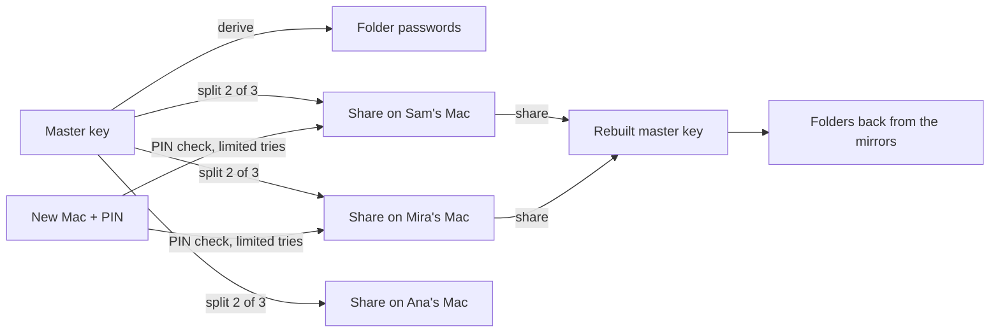

# Recovery: getting your folders back on a new Mac

Decisions made by the Principal on 2026-10-14. This records where recovery
stands today, why it isn't good enough, and the direction we chose. It is a
direction, not a design: the open questions at the end come first.
Related: [scenarios/mirroring.md](scenarios/mirroring.md),
[gates.md](gates.md), [trust-framework.md](trust-framework.md).

## Today

Every mirrored folder has its own Syncthing folder password. It is
generated when mirroring starts and lives only in the Mac's login Keychain.
Friends hold the folder encrypted with it, so without the password the
mirrors are unreadable, to them and to the owner alike.

The **recovery kit** (`Casper setup recovery-kit`, in
`agent/internal/setup/commands.go`) collects those passwords, plus any
backup keys, into a file locked with a passphrase the person types into a
macOS dialog (12+ characters, age scrypt encryption). On a new Mac,
`Casper setup restore --kit FILE` puts the passwords back into the Keychain,
and the agent then calls `restore_folder`.

Its problems:

- **It's saved in the wrong place.** The kit goes to
  `~/Documents/Casper Recovery Kit (<user>).txt`, and Documents is the
  folder people mirror. The mirrored copy of the kit is encrypted with the
  very password it holds, so after losing the Mac it can't unlock itself.
- **It goes stale.** It holds one password per folder, so every newly
  mirrored folder needs a new kit. Nothing reminds anyone.
- **It rests entirely on the person.** They must copy the file somewhere
  other than the Mac and remember a long passphrase, possibly years later.
  Most people won't do either.
- **Restore needs an agent.** There is no guided path: the steps are a CLI
  command and an MCP tool call.
- **It has never been tested live.** Only `tests/test_mirror_integration.py`
  exercises a rebuild, and it hands the lost Mac's passwords over directly
  rather than going through a kit.

## Decided direction

**(a) One master key per person.** Each folder password is derived from it
(for example HKDF over the folder ID), as are any other keys Casper needs.
Recovering the master key recovers everything, including folders mirrored
after recovery was set up, so recovery material never goes stale.

**(b) The master key is split among friends' Macs** with threshold secret
sharing (Shamir), for example 2 of 3: any two friends' Macs together can
rebuild it, and one alone learns nothing. Holding a share is tiny (bytes),
so even a friend with no spare disk can be a recovery holder. That gives
everyone in a group a way to help.

**(c) Shares are released automatically to whoever proves they know the
person's 4-digit PIN**, with no action needed from the friends, and with
strict guess limits on each friend's Mac. Neither Casper's server nor any
single friend can recover the key.

- Precedent: Signal's Secure Value Recovery, which protects a short PIN
  with a hard guess limit
  ([Signal](https://signal.org/blog/improving-registration-lock/),
  [analysis](https://blog.cryptographyengineering.com/2020/07/10/a-few-thoughts-about-signals-secure-value-recovery/)).
  Its current version, SVR3, splits the secret across three kinds of
  hardware so no one of them is a single point of attack
  ([paper](https://eprint.iacr.org/2024/887.pdf)). The
  [Juicebox protocol](https://eprint.iacr.org/2025/348) does the same with
  a PIN, a threshold OPRF and secret sharing across independently run
  servers. Our share holders are friends' Macs instead of servers.
- The attack math: a 4-digit PIN has 10,000 values. With about 10 tries per
  holder and 3 holders, an attacker can test at most about 30 PINs, a 0.3%
  chance of success, and must then still have tries left on a second
  holder. A 6-digit PIN cuts that to 0.003%.
- The limit is enforced by software on a Mac the friend controls. A friend
  who tampers with their own Mac can reset their own counter, so the
  protection against one dishonest friend has to come from the threshold
  and from the PIN check being designed so that one holder alone can't
  test guesses offline. Two colluding friends (in 2 of 3) could recover the
  key; that is the trust the person places in choosing them.

**(d) Optional, not default: "the friendly failsafe"** for a forgotten PIN.
The person asks to recover without the PIN; Casper notifies them (on every
device and channel it has) and their recovery holders; after a waiting
period (for example 48 hours) during which the person or any holder can
stop it, the holders' Macs release their shares. Precedents: social-recovery
wallets, where guardians approve a key change and a waiting period lets the
owner cancel a hijack (Argent uses 36 hours;
[Buterin](https://vitalik.eth.limo/general/2021/01/11/recovery.html)), and
Apple's account recovery, which waits days and can't be hurried
([Apple](https://support.apple.com/en-us/118574)). This is the ultimate
friendly failsafe, and it is opt-in because some people will feel less
secure knowing it exists.

**(e) The downloadable kit becomes optional**, for people who want their
own copy (and it should not be saved inside a mirrored folder).

**(f) Recovery becomes a guided flow, "I lost my Mac"**, on the website and
in the Casper app, with no agent needed: sign in on the new Mac, enter the
PIN, Casper gathers the shares, rebuilds the key and pulls the folders back
from the mirrors.

## Open questions

- **Placement with only one friend.** 2 of 3 needs three holders. Options:
  the person's own other Mac as a holder, Casper's catcher as one holder
  (it must never be enough alone), or 1 of 1 with the kit strongly
  suggested until a second friend joins.
- **Friends leaving.** When a holder leaves, revokes, or their Mac is gone
  for good, Casper re-splits the key among the remaining and new holders
  and invalidates the old shares. How fast must that happen, and what if too
  few holders remain?
- **Changing the PIN.** Rotation means re-registering with every holder.
  What if some are offline at the time?
- **The PIN check itself.** It must prove knowledge of the PIN without
  revealing it, and without letting any one holder test guesses offline:
  an OPRF-style design (threshold OPRF as in Juicebox, or
  [OPAQUE, RFC 9807](https://www.rfc-editor.org/rfc/rfc9807.html)). How
  holders count guesses, and whether a Mac's Secure Enclave can make a
  counter harder to reset, needs a design pass.
- **Migrating today's folders.** Existing folder passwords are random, not
  derived. Wrap them under the master key, or re-key folders (Syncthing
  would re-send the encrypted data)?
- **Recovery as a gate** ([gates.md](gates.md)). Recovering and the failsafe
  are intent items of the highest stakes: whose surfaces may start them,
  who may stop them, and what each holder is shown.
